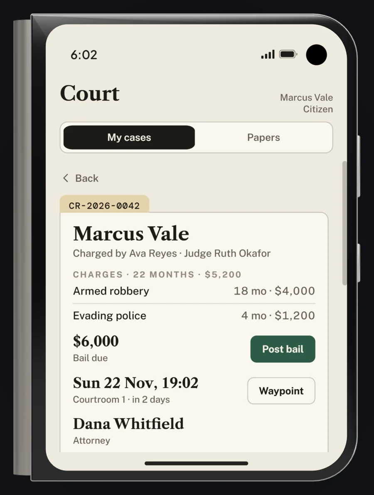
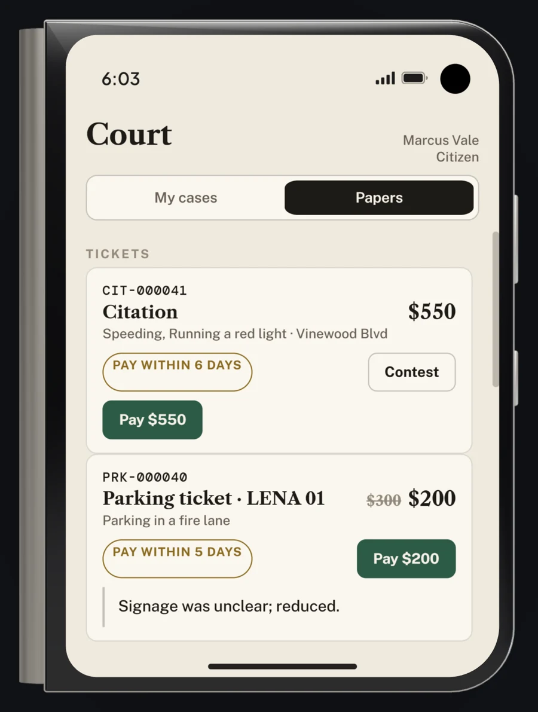
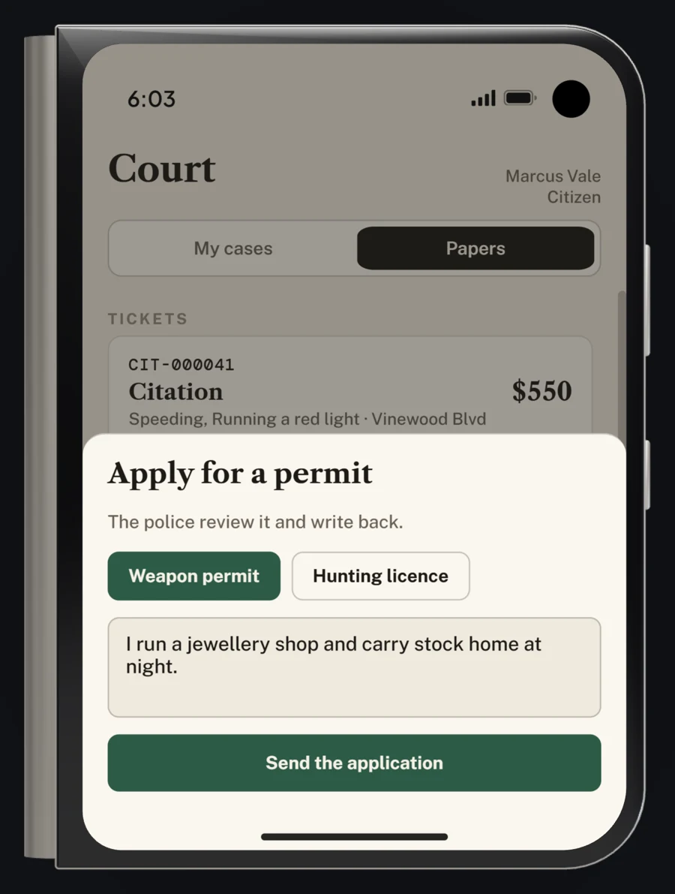
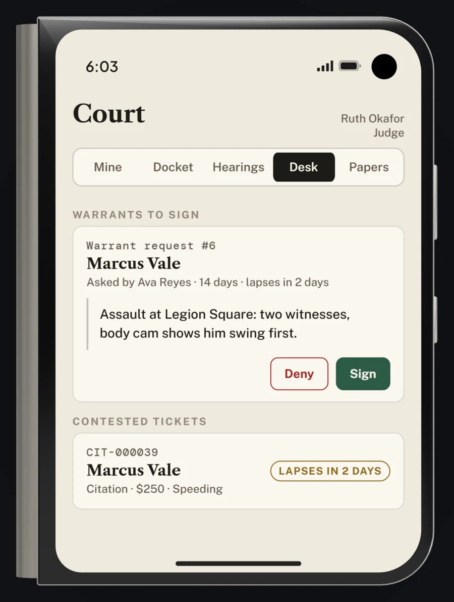
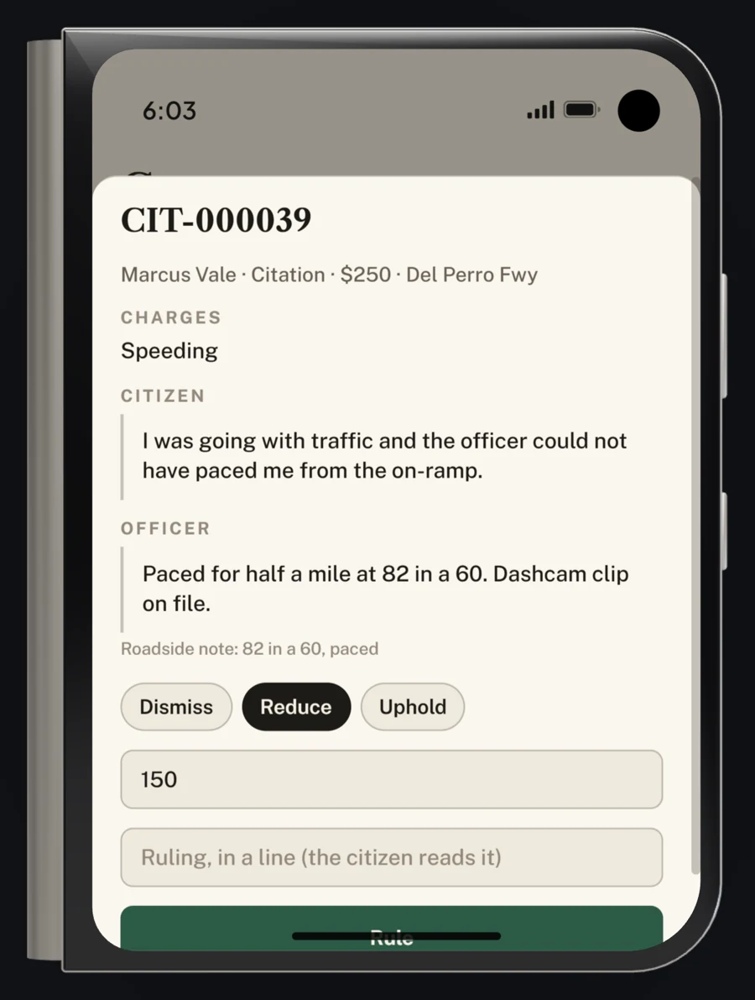

# pure-whip-courts

> Works on **FiveM Legacy** and **GTA V Enhanced**.

**Courts, bail and a court app for [WHIP](https://whipfx.net), by [PureFX](https://purefx.dev).**

A suspect booked by an officer pleads guilty (sentenced at once, with a discount) or not guilty (a court case with bail
or remand, a hearing, plea deals, attorneys, a judge's ruling). Citizens handle their tickets, impounded cars, permits
and complaints from the same app. Built on whip_core, whip_phone and the exports of
[pure-whip-police](https://github.com/fozenistaken/pure-whip-police).

More from PureFX at **[purefx.dev](https://purefx.dev)**.

## Features

| | | |
|---|---|---|
|  |  |  |
| **A case:** charges, bail, the hearing, your attorney, a plea deal on the table, motions and the docket | **Papers:** tickets to pay or contest, impounded cars with the bill, letters from the city | **Permits and complaints:** apply for a permit, file a complaint about an officer |
|  |  | |
| **Judge's desk:** warrant requests to sign or deny, contested tickets | **Ruling:** dismiss, reduce or uphold, with the citizen's reason and the officer's statement beside it | |

## Install

`ensure pure-whip-courts` after `pure-whip-police` and `whip_phone`. Tables are made on start. Settings are in
`config.lua` (each with a comment and a range). The police job finds it through its `Config.Providers.courts`.

## Playing it

| Who | What |
|---|---|
| Officer | MDT → person → Charge → Arrest → **Book: ask for a plea** (the suspect must be cuffed beside you) |
| Suspect | A plea question on screen: Guilty (time and fine cut by the plea discount) or Not guilty (a case; bail or held for court) |
| Anyone | **Court** app on the phone (`/court`): your cases, post bail (also for someone else by case number), pick an attorney, take or turn down a plea deal, file motions |
| Attorney (`lawyer` job) | Clients tab: take or decline a client, file motions |
| Court staff (`doj` job, on duty) | Docket and Hearings tabs: set or deny bail, set hearings, offer plea deals and drop charges (prosecutor), rule: guilty (on the charges that stand, bail can pay the fine), not guilty, dismissed, failed to appear (bail forfeited, warrant) |
| Anyone | **Papers** tab: police tickets (pay one, or contest an unsigned one before its date with a reason), impounded cars (the bill with storage, pay it, when the hold ends) and letters from the city (impound, tickets, rulings); apply for a permit and see the answer; file a complaint about an officer |
| Judge (`rule`) | **Contests** tab: contested tickets with the citizen's reason and the officer's statement; dismiss, reduce (never above the ticket) or uphold (a new date to pay). An unheard contest drops in the citizen's favour after pure-whip-police's `Config.Tickets.contestDays` |

Nobody stays stuck: remand ends after `Config.Remand.minutes`, and a case with no hearing after `Config.CaseDays` is
dismissed with bail paid back. A sentence given while the defendant is away is served the moment they log in.

## Exports (server)

Results, or `false, why`.

| Export | Returns |
|---|---|
| `Arraign({ officer, suspect, charges, dept, reportId })` | `true` (the plea is asked in the background) |
| `OpenCase({ charId, charges, byCharId, dept, reportId })` | case id, bail state, bail |
| `GetCase(id)` / `GetCases({ charId? , status? })` | case with docket / list |
| `SetBail(id, amount│nil)` / `PostBail(id, payerSource)` | `true` |
| `ScheduleHearing(id, unixTime, courtroom)` | `true` |
| `Rule(id, 'guilty'│'not_guilty'│'dismissed'│'no_show', { codes, applyBail, byCharId })` | `true` |

## Events (server)

`pure-whip-courts:` followed by `caseOpened`, `bailPosted`, `hearingSet`, `ruled`, `caseClosed`.

## Tests

`lua tests/run.lua .` runs the court logic tests (bail, plea discount, settling bail against a fine, reminders).

## Credits

- **Made by [PureFX](https://purefx.dev).** More scripts and updates at **[purefx.dev](https://purefx.dev)**.
- **[WHIP](https://whipfx.net)** by [WHIPFX](https://github.com/WHIPFX) (LGPL-3.0): the framework this is built on.
- **Fonts:** Libre Caslon Text, Public Sans and DM Mono, SIL Open Font License 1.1 (texts in `html/court/fonts/`).
- The screenshots above are the real UI rendered in a browser with sample data.

## Licence

GPL-3.0, see [LICENSE](LICENSE). Copyright 2026 [PureFX](https://purefx.dev).
